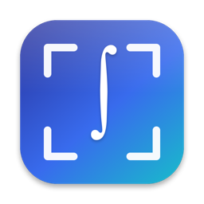

# InkEquation

Snip any equation on your screen and paste it into LaTeX, Markdown, Word or PowerPoint.

**Mac App Store: coming soon** ·
[Website](https://perseus-sepahi.github.io/software/inkequation/) ·
[Support](https://perseus-sepahi.github.io/software/inkequation/support/)

## What it does

- **Snip over any app.** Press a shortcut and drag a box around an equation in a PDF, a browser, a slide or a paused video.
- **Paste into Word and PowerPoint** as native equations you can edit, not pictures or code.
- **LaTeX, Markdown and MathML**, with a live preview you can edit.
- **Private by default.** Recognition runs on your Mac with Apple's on-device model and works offline.
- **Whole PDFs** to Markdown with LaTeX math, keeping headings, tables and figures; export to LaTeX, Word, HTML or PDF.
- **Handwriting pad** and a searchable **library** of everything you've snipped.
- **Optional engines:** open-source models through [Ollama](https://ollama.com) on your Mac, or Claude with your own Anthropic API key.

## Free and Full Access

Free, with no limit: snipping, LaTeX/Markdown/MathML copies, handwriting, the library and Markdown export. Also free: 5 Word/PowerPoint copies a day and the first 5 pages of each PDF.

**Full Access** is US$19.99 a year, starting with a two-week free trial. It adds unlimited Word/PowerPoint copies, whole PDFs, LaTeX/Word/HTML/PDF export and the Ollama and Claude engines.

## Requirements

A Mac with Apple silicon and macOS 27 or later, with Apple Intelligence turned on for the on-device engine.

## Privacy

No accounts, analytics or tracking. Snips and documents stay on your Mac. See the [privacy policy](https://perseus-sepahi.github.io/software/inkequation/privacy/).

## Reporting bugs

Open an [issue](https://github.com/perseus-sepahi/inkequation-app/issues). Include your macOS version, the InkEquation version (**Settings ▸ About**), and if an equation came out wrong, the image you snipped.

## Licence

The application is proprietary: see [LICENSE.md](LICENSE.md). Third-party components and their licences are listed in [THIRD-PARTY-NOTICES.md](THIRD-PARTY-NOTICES.md).

© 2026 Perseus Sepahi
